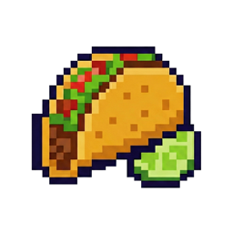
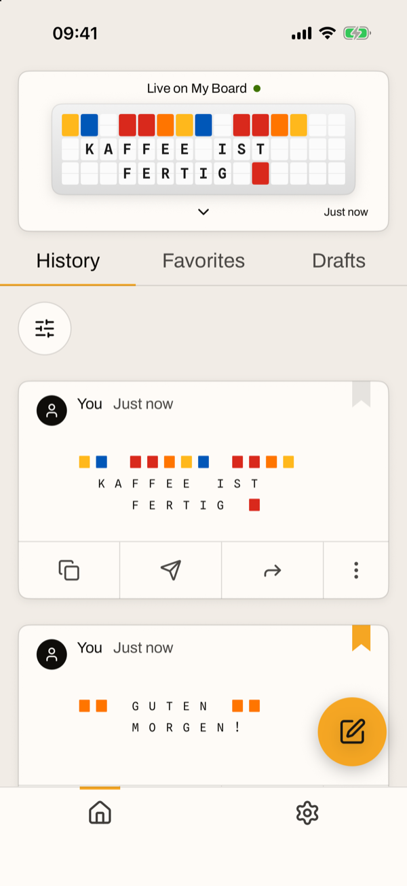
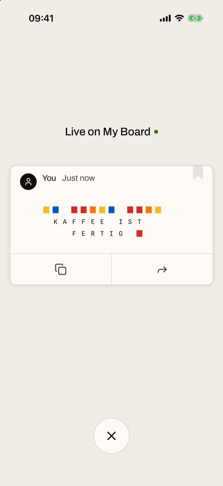
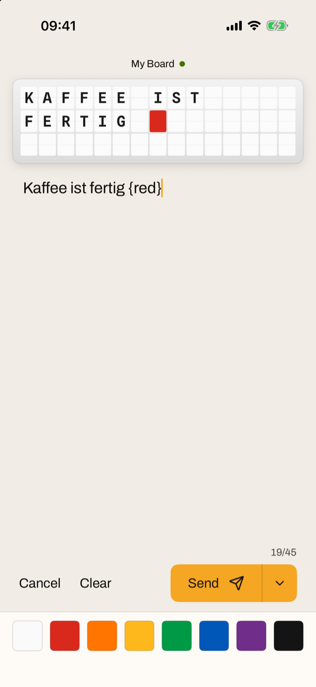
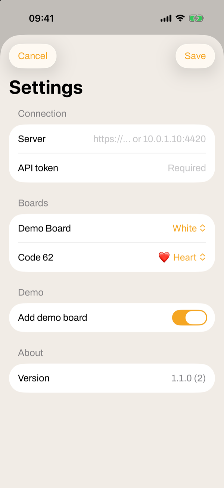

<p align="center">
  
</p>

<h1 align="center">FiestaBoard for iPhone</h1>

<p align="center">
  Your <a href="https://github.com/Fiestaboard/FiestaBoard">FiestaBoard</a> in your pocket, in FiestaBoard's own look:<br>
  <b>what your board shows</b>, live, and <b>a message to it</b> in a few taps — at home, through a VPN, or from anywhere.
</p>

<p align="center">
  <picture>
    <source media="(prefers-color-scheme: dark)" srcset="docs/screenshots/home-dark.png">
    
  </picture>
  &nbsp;
  <picture>
    <source media="(prefers-color-scheme: dark)" srcset="docs/screenshots/live-dark.png">
    
  </picture>
  &nbsp;
  <picture>
    <source media="(prefers-color-scheme: dark)" srcset="docs/screenshots/compose-dark.png">
    
  </picture>
  &nbsp;
  <picture>
    <source media="(prefers-color-scheme: dark)" srcset="docs/screenshots/settings-dark.png">
    
  </picture>
</p>

---

## Why

[FiestaBoard](https://github.com/Fiestaboard/FiestaBoard) runs your display on your own network — a split-flap board, an LED matrix, a TV — from your own pages, schedules and plugins. This app puts it in your pocket: no account somewhere else, no cloud in between. It talks only to your FiestaBoard, and your history, favorites and drafts stay on your iPhone.

## What it does

**The board, live.** On top, a card shows what your board shows right now and since when, read again every 15 seconds while the app is open and on pulling down. Tap it for the board large: whether it is paused or follows its schedule, and buttons to copy the message into a new one, keep it as a favorite or share it.

**History, Favorites and Drafts.** Below, as cards: who put a message there and when, the ribbon in the corner to keep it as a favorite, and a bar to copy it into a new message, send it again, share it or delete it. Sort by recent or oldest, and by who sent it. FiestaBoard keeps no history of its own, so the app keeps it on the iPhone: what you sent from the app (*You*) and what the board showed while the app was open (*FiestaBoard*).

**Writing a message.** The round button opens it. The board above shows where your text will land as you type — laid out as FiestaBoard lays it out: from the top left, word-wrapped, a line break where you type one — with how many tiles it takes. The colour tiles below put one in. **Send** says whether it reached the board or why not: a paused board, or one in its quiet time, which holds the message until that ends. **Save Draft**, next to Send, keeps it for later.

It talks to nothing but your FiestaBoard, over its public API (`/api/v1`), with an API token.

## What you need

- A **FiestaBoard** install, with **login switched on** wherever it can be reached from the internet.
- An **API token**: in FiestaBoard, **Settings → AI**. It opens FiestaBoard's whole API, so the app keeps it in the iPhone's Keychain and sends it only to the address you set.
- **A way to reach FiestaBoard** from where the iPhone is — one of the three below.
- **Xcode 27** on a Mac to put the app on the iPhone, which needs **iOS 18** or later. It is not on the App Store.

## Reaching FiestaBoard

The app takes an `https://` address from anywhere, and a plain `http://` one only where it cannot be reached from the internet: 10.x, 172.16–31.x, 192.168.x, 100.64–127.x (Tailscale's range), a `.local` name, a name without a dot, or a private IPv6 address. Typed without `http://` or `https://`, an address gets the one that fits.

### At home

FiestaBoard's address on your network, such as `10.0.1.10:4420`. The first time, iOS asks whether the app may use the local network; allow it.

### Through a VPN

The same address from anywhere, with a VPN into your home network: **WireGuard** on the router (a FritzBox has it built in), or **Tailscale** on the FiestaBoard machine and the iPhone, then its `100.x.y.z:4420`. Nothing is opened to the internet.

### From anywhere, over HTTPS

A name of your own, a certificate, and only the API passed through to FiestaBoard. [Caddy](https://caddyserver.com) does all three and fetches and renews a Let's Encrypt certificate by itself. Here it runs in Docker beside FiestaBoard, as on a Raspberry Pi.

**1. A name for your home.** At your domain's DNS provider, an **A record** such as `fiestaboard.example.com` → your home's public IP address. If that address changes, keep the record up to date with your provider's DynDNS, which a FritzBox can update.

**2. Caddy's configuration**, in `~/caddy/Caddyfile`: only `/api/v1/…` goes on to FiestaBoard, and everything else — its web UI, its login — answers 404.

```caddyfile
fiestaboard.example.com {
	@api path /api/v1/*
	handle @api {
		reverse_proxy fiestaboard:3000
	}
	handle {
		respond 404
	}
}
```

**3. Caddy in Docker**, in FiestaBoard's Docker network, so it reaches the container as `fiestaboard:3000`. Ports 80 and 443 are often taken on the machine already — by deCONZ or a web server, say — so Caddy gets two free ones:

```sh
docker run -d --name caddy --restart unless-stopped \
  --network fiestaboard_default \
  -p 8081:80 -p 8443:443 \
  -v ~/caddy/Caddyfile:/etc/caddy/Caddyfile:ro \
  -v ~/caddy/data:/data -v ~/caddy/config:/config \
  caddy:2.10
```

`fiestaboard_default` is the network FiestaBoard's Docker Compose made; `docker network ls` lists it.

**4. Two port forwards on the router**, to the machine Caddy runs on (on a FritzBox: Internet → Freigaben → Portfreigaben):

| From the internet | To the machine |
|---|---|
| TCP 443 | 8443 |
| TCP 80 | 8081 |

Port 80 is only for Let's Encrypt, to hand out and renew the certificate.

**5. Check it** from outside your network — on the iPhone with Wi-Fi off — at `https://fiestaboard.example.com/api/v1/health`: `{"status":"ok", …}`, without a certificate warning. Until the name and the ports work, Caddy keeps trying for the certificate and waits longer each time; `docker restart caddy` makes it try at once, and `docker logs caddy` says how it went.

In the app: `https://fiestaboard.example.com` and your token.

## Putting it on your iPhone

1. Connect the iPhone to the Mac with a cable, unlock it and trust the computer.
2. Open `FiestaBoard.xcodeproj` in Xcode. Under the **FiestaBoard** target → **Signing & Capabilities**, choose your Apple ID as the **Team**. If Xcode says the bundle identifier is taken, change it to one of your own.
3. Choose the iPhone as the run destination and press **Run**.
4. The first time, Xcode says the iPhone needs **Developer Mode**: on the iPhone, **Settings → Privacy & Security → Developer Mode** (it appears only once Xcode has tried), switch it on, let it restart, and press Run again.
5. The first time the app starts, iOS asks you to trust your certificate: **Settings → General → VPN & Device Management** → your Apple ID → **Trust**.

With a free Apple ID the app runs for 7 days and is then put on again the same way; its history, favorites and drafts stay. With the paid Apple Developer Program it runs for a year, and TestFlight puts it on iPhones without a cable.

## Building

The files in `FiestaBoard/` are the project: Xcode picks up whatever is in the folder. A debug build started with these arguments shows sample content, without a FiestaBoard and apart from the real history:

| Argument | Shows |
|---|---|
| `-demo` | Home, with a sample board, history, favorite and draft |
| `-demo -demoLive` | the board large |
| `-demo -demoCompose` | writing a message |
| `-demo -demoSettings` | the first start |

## Icon, colours, typefaces and icons

All of them are FiestaBoard's:

- **The icon** is FiestaBoard's taco (`fiesta-icon.png` in the FiestaBoard repository, MIT licence), on white. `tools/make-icon.swift` makes it:

  ```sh
  swift tools/make-icon.swift <path to fiesta-icon.png> FiestaBoard/Assets.xcassets/AppIcon.appiconset/AppIcon.png
  ```

- **The colours** are those of FiestaBoard's web UI (`@fiestaboard/ui`), in light and dark: warm beige or warm near-black, and FiestaBoard orange for whatever is primary or chosen.
- **The typefaces** are FiestaBoard's: Archivo for words and Spline Sans Mono for the board, both under the SIL Open Font License.
- **The icons** are [Lucide](https://lucide.dev)'s, as in FiestaBoard's web UI, under the ISC licence.

Their licences are in `FiestaBoard/Licenses/`, and go with the app.

## Licence

MIT, see [LICENSE](LICENSE). The icon is FiestaBoard's, under its own MIT licence. This app is not made by the FiestaBoard project.
